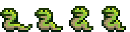
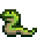

# Wiki media

The spelunky.ai wiki's images come from the game's own assets, exported by scripts rather than drawn or
screenshotted, so a page can't show a sprite the game doesn't have, and its clips are recorded from the port
playing committed inputs, so a page can't show a move the game doesn't make. The output is committed, in
`wiki/media` (with `LICENSE.txt` and a notice, `docs/wiki-license.md`), and the site serves it from there: a
change to what it's made from commits what it renders in the same pull request, and CI checks it's what the
pull request renders, byte for byte ([Committing](#committing)). The pages' numbers come from the game's code
the same way ([wiki data](wiki-data.md)).

## Sprites

```sh
scripts/wiki-media     # everything, into wiki/media (below)
scripts/wiki-sprites   # only the sprites, into wiki/media/sprites; --scale N for another upscale factor (default 4)
```

`scripts/wiki-sprites` (after `scripts/extract`) runs `tools`' `wiki-sprites` binary on the extracted bundle (`bundle.bin` and the
atlas pages). It replaces the output directory as a whole, and the same bundle always gives byte-identical
files (`crates/tools/tests/wiki_sprites.rs`). Every PNG carries the copyright notice in a `Copyright` text
chunk.

| Path | Contents |
| --- | --- |
| `index.json` | The notice, `scale`, `room_speed`, `default_fps`; every sprite (`name`, `id`, `frames`, `width`, `height`, `fps`, `meta`: its `sprite.json`); and every object that uses a sprite (`sprite`, its own; `mask`; `sprites`, all it uses) |
| `<sprite>/sprite.json` | Size, origin, collision `bbox` (inclusive; the union of the frames'), `fps` and `fps_source`, the file paths, each frame's `bbox`, `objects` (whose own sprite it is) and `used_by` |
| `<sprite>/frames/<i>.png`, `<i>@4x.png` | Each frame, at native size and upscaled (nearest neighbour) |
| `<sprite>/strip.png`, `strip@4x.png` | The frames side by side, left to right: a sprite sheet for a CSS `steps()` animation |
| `<sprite>/anim.png`, `anim@4x.png` | Sprites with several frames: an APNG that loops at `fps` |

Paths in the JSON are relative to the output directory. Sprite directories use the sprite's name.
`sSnakeWalkL`'s strip and preview, at 4×:

 

An object's `sprites` are its own sprite, its mask, and every sprite its events name in GML or in an
action's argument. Sprites it only gets through a script it calls aren't followed (the player's come from
`characterSprite`), so curated entity pages may need to add some.

**Frame rate.** GM advances `image_index` by `image_speed` every step, at 30 steps a second. The speed is
known when an object whose own sprite it is sets `image_speed` to a number at the top level of its create
event, or inherits one, with nothing conditional changing it (`fps_source.via` is `"sprite"`). It is a
weaker hint when only an object that uses the sprite does (`"uses"`; oSnake's 0.4 for `sSnakeWalkL`).
Otherwise `fps_source` is `null` and the preview plays at `default_fps`: 15, from an `image_speed` of 0.5,
the value the game's code sets most often. An `image_speed` of 0 means the object holds the sprite still
and picks frames in code (oBow's `sBowRight`); its preview plays at `default_fps` too.
In the game, speeds often change with state (the player's run speeds up with its velocity), so `fps` is a
suggestion for a preview, not a fact for a page.

**Why APNG.** The `png` crate the workspace already uses writes APNG, every current browser plays it, and it
keeps full alpha losslessly. Animated WebP would need libwebp (a C library) or a hand-written muxer, for
files a few hundred bytes smaller.

## Clips

```sh
scripts/wiki-media [SPEC...]                # render them into wiki/media/clips, to commit (below)
scripts/wiki-clips --check                  # only check the specs' story facts (after scripts/extract)
scripts/wiki-clips --out DIR SPEC...        # render some into DIR, to look at them
```

A clip is a spec in `wiki/clips/<entity>/<move>.toml`; its id is that path (`snake/bite`). Its source is a
committed replay, cut to a frame range, or a **staged scene**: a custom level (docs/source-inventory.md 7.3)
the player starts in, with a few inputs, to show one monster and the player, like a game's ability videos.
A replay in `fidelity/settings/` plays the settings program, `config.exe`, as `fidelity-check` does
(below, "The settings program").

```toml
title = "Spider drop"                     # the clip's name, for a page and its VideoObject
description = "A spider hanging from ..." # a sentence or two (the VideoObject's description)
from = 0                                  # the first and last frames shown, inclusive (90 to 600 frames)
to = 109
poster = 66                               # the frame the poster shows, after the notice's 60
story = "-oSpiderHang@62 +oSpider@62 plife=3@88 !plife<3"
# scale = 2                               # output pixels per game pixel: 2 (640x480, the default) or 4
# loop = true                             # whether the page loops it (the default)

[scene]                                   # or, instead: replay = "fidelity/replays/enemy-mines-seed-1-kills.txt"
# seed = 0                                # the RNG seed at startup
# lives = 4                               # the player's hearts, bombs and ropes (the editor's default, 4)
level = '''
1111111111111111111111
1000000000000s00000001
10000@0000000000000001
1111111111111111111111
'''
inputs = '''
20 hold right 45                          # replay event lines, in scene frames
'''
```

- **Frames** are the source's: the replay's, or the scene's, whose frame 0 is its first in the level.
- **The level** is rows of the level editor's tile codes (`scrCreateTileObj`: `1` a brick, `@` the
  entrance, `n` a snake, `b` a bat, `s` a hanging spider, `h` a caveman, `K` a skeleton...), up to 40 by
  32, padded with `0` (nothing), with exactly one entrance. Rows start at room pixel 16 and the view
  follows the player, so a scene a dozen rows tall fills the picture.
- **The story** is [story facts](formats.md#stories), checked on the frames the clip shows (each window
  cut to `from`..`to`, and a fact without one gets them all): at least one that must hold, so a game change
  that takes a clip away from what its page says fails `scripts/check`, as a replay's story would. A
  condition must become true in the clip. A scene also has to have loaded its level.

`wiki-clips` (in `crates/harness`, `harness::clip`) turns a scene into a replay: `file levels/wiki.lvl`
with the level, then the boot `custom-chain-end.txt` uses (the intro and title skipped with X, F3 for the
load-level menu, a click on its only level and Enter on frame 240; scene frame 0 is frame 241), then the
inputs. `--replays DIR` writes them, for `replay-story` while writing a spec (its frames, less 241, are
the scene's) or for `scripts/fidelity`: the first four scenes matched the oracle frame for frame. It plays
every source as the app does, with the sound DLL modelled from the game's sounds (replays are recorded
against the oracle's stub, which rarely makes a difference), and checks the facts. Rendering, the app
captures the frames headless (`app --capture-from F`), rendering the frames before the clip's only as far
as its pixels need them (`app::unrendered`: most draw into what a later frame clears, but the pause screen
and a dark level's light keep theirs), `wiki-clips` scales them down to
the program's own pixels (the game's 320x240) and up again by `scale`, nearest neighbour, mixes the sound, and ffmpeg encodes them.

**The settings program.** A clip cut from a replay in `fidelity/settings/` plays the settings program on its
own assets (`<assets>/config`) and the game's sounds, as `app --settings` does, and the app captures it with
`--settings`. Its window is its rooms' view ports, at twice their views, but they draw at the window's
resolution: the background's bricks and the sliders have detail finer than a room pixel. So its own pixels
are the window's, which `scale` multiplies like the game's: `rInit`'s 416x600 comes out 832x1200 at 2, and
`rKeyConfig`'s 320x240 640x480. The rooms' windows differ, so the check takes the clip's size from the run
(`World::window_size`) and fails a clip whose frames are in windows of two sizes. The page shows a clip at
most 600 pixels tall, which a 4:3 clip at 640 wide never is, so the tall window shows at its own size. The
mouse pointer is the computer's, not drawn by the program, so it isn't in the picture: a clip's description
says what was clicked.

**The sound.** A clip has the game's sound effects and music, as the app plays them (`Clip::sound`). The
app's player (`audio::backend::Player`, kira) follows the commands the sound model makes each tick; to
record them, `wiki-clips` plays the source again headless and hands each tick's commands to the same
player on a kira backend with no device (`audio::offline`), which mixes exactly one tick, 1600 stereo
frames at 48 kHz, after each. So the volumes, pans, rates, loops, kira's resampling and its 10 ms fade on a
cut-off sound are the live player's, and a frame's sound starts with its picture, as the app hands the
player a tick's commands right after drawing it. The mix runs from boot, so music already playing at the
clip's first frame is there, from where it had got to; only the clip's frames' ticks are kept. Two things
differ from the device: the clock (live, the commands land between the device's buffers at wall-clock
times; here, between ticks), and the music, which kira streams on a thread of its own live but which is
decoded whole when it starts here (as on wasm), since that thread's timing would decide what got mixed.
Nothing touches an audio device or the wall clock, and the same commands always mix the same samples
(`crates/harness/tests/clip_sound.rs` checks `snake/bite`'s, with the reference zip's sounds, and that the
bite's sound starts on the bite's frame). ffmpeg encodes them as AAC and Opus, which decode to exactly the
clip's samples, no more and none shifted (the MP4's edit list and the WebM's padding trim the codecs'
priming and last packet); a clip that's silent throughout gets no sound track.

**The notice.** Clips carry no notice in the picture: the pages that show them have it in their header
line and footer (docs/wiki-license.md, Decisions). It's in the files' metadata
(`copyright`, and the caption as `comment`), and in the poster's `Copyright` text chunk. A clip with sound
has the audio credit after the notice in `copyright`, and the pages that show one have it in their footer.

| Path | Contents |
| --- | --- |
| `index.json` | `format` (2), the notice, `license`, the `caption` (the videos' `comment`), the `audio_credit` (docs/wiki-license.md), `fps`, and every clip's `clip.json` |
| `<id>/clip.json` | `id`, `title`, `description`, `spec`, `source` (`{"kind":"replay","replay":...}` or `{"kind":"scene","seed":...}`), `from`, `to`, `frames`, `replay_from` (the replay's frame the clip starts on: `from`, past a scene's boot and load, `harness::clip::SCENE_START`), `fps`, `duration` (seconds), `width`, `height`, `scale`, `loop`, `poster_frame`, `frames_hash`, `has_audio` (whether the videos have a sound track), `audio_hash` (or `null`), `encoding`, `files`, the notice, `license` and `caption` |
| `<id>/clip.mp4` | H.264, 4:2:0, `+faststart` (playable before it's all in), for every browser; AAC, 128 kb/s |
| `<id>/clip.webm` | VP9, 4:2:0, smaller where it plays; Opus, 96 kb/s |
| `<id>/poster.png` | The `poster` frame, at the clip's size |
| `<id>/replay.txt` | The replay the game plays the clip from on its page: a scene's, or the committed replay to the clip's last frame (`harness::clip::Clip::live_replay`). None for the settings program's |

Paths in the JSON are relative to the output directory. The scale is even so that the videos' colour, at
half resolution, never mixes two game pixels. The frames are the same on every run of the same port and
assets, and `frames_hash` says so (`harness::fingerprint`'s hash of each frame in game pixels, then of
those hashes). `audio_hash` is the same hash of the mixed samples (little-endian `f32`s) before ffmpeg has
them: the same on every run on the same kind of machine (kira mixes with the platform's float functions,
which needn't round alike everywhere, unlike the game's state). `encoding` is the same hash of the rest of
what the videos are encoded from: ffmpeg's `-version` and every argument it's given but its files' paths
(the codecs' options, the files' metadata). The three decide the videos' bytes ([Committing](#committing)), so
`--reuse DIR` keeps the videos of a clip rendered in DIR whose three are the same, and encodes only the
others. A render makes each clip in a scratch directory (`.scratch/<id>`), and replaces the clip's directory
with it once it's done, so a clip whose render fails stays as it was; one of
every spec also removes the clips whose spec is gone (if the output directory holds a render: one without
`index.json` is left alone), and `index.json` lists every clip there. `--jobs N` checks or renders N at a time (8).

The first set, for the Mines monsters' pilot pages (851-3347): `snake/bite`, `bat/swoop`, `spider/drop`
and `caveman/charge` are scenes; `snake/stomp`, `snake/thrown-rock`, `bat/jump-kill` and `skeleton/rise`
are cut from replays. The pilot's pages added six scenes: `giant-spider/drop`, `giant-spider/web` (seed 9,
so its web shot comes early), `giant-spider/bomb`, `caveman/stun`, `caveman/ledge` (seed 9) and
`skeleton/whip`. The quirks' pages (851-3360) have theirs under `quirks/`, each a quirk of
[docs/quirks.md](quirks.md) played out: `quirks/thrown-item-nearest-enemy`, `quirks/pickup-nearest-enemy`,
`quirks/caveman-sight-alerts-others`, `quirks/caveman-ledge-slide`, `quirks/skeleton-faces-right`,
`quirks/whip-hits-every-step`, `quirks/yeti-king-touch-custom-level`, `quirks/yeti-king-whip-wind-up`,
`quirks/yeti-never-charges`, `quirks/tomb-lord-whip-wind-up`, `quirks/mitt-gravity-one-step`,
`quirks/mitt-catch-every-rock`, `quirks/yeti-stomp-rising`, `quirks/yeti-stomp-sixteen-steps`,
`quirks/mattock-wind-up-twice`, `quirks/mattock-wrong-block`, `quirks/giant-spider-whip-wind-up`,
`quirks/bomb-arrow-free`, `quirks/teleporter-old-target`, `quirks/parachute-torn-moving-right`,
`quirks/jetpack-vanishes-player-invisible`, `quirks/jar-whip-rolls-twice`, `quirks/skull-breaks-on-ceiling`,
`quirks/jar-shot-in-hands`, `quirks/chest-trap-bomb-taken-out`, `quirks/arrow-trap-sensor-left-wider`,
`quirks/smash-trap-random-throw`, `quirks/web-jump-wears-wrong-web`, `quirks/shopkeeper-patrol-one-step`,
`quirks/damsel-whip-hop-thrown`, `quirks/thrown-monster-full-push` and `quirks/two-damsels-one-heart` are cut
from staged scenes' replays
(`action-throw-rock-nearest-enemy.txt`, `action-pickup-nearest-enemy.txt`, `enemy-caveman-sight-alerts-hawkman.txt`,
`enemy-caveman-ledge-slide.txt`, `enemy-skeleton-tile-faces-right.txt`, `enemy-megamouth-whip-every-step.txt`,
`enemy-yeti-king-custom-level-touch.txt`, `enemy-yeti-king-whip-wind-up.txt`, `enemy-yeti-sight-never-charges.txt`,
`enemy-tomb-lord-whip-wind-up.txt`, `item-mitt-gravity-one-step.txt`, `item-mitt-catch-every-rock.txt`,
`enemy-yeti-stomp-rising.txt`, `enemy-yeti-stomp-sixteen-steps.txt`, `weapon-mattock-wind-up-twice.txt` (the
`mattock/wind-up` scene), `weapon-mattock-wrong-block.txt`, `enemy-giant-spider-whip-wind-up.txt` (the
`giant-spider/wind-up` scene), `weapon-bow-bomb-arrow-free.txt`, `weapon-teleporter-old-target.txt`,
`item-parachute-torn-moving-right.txt`, `item-jetpack-player-invisible.txt`, `item-jar-whip-rolls-twice.txt` (the
`jar/whip` scene), `item-skull-breaks-on-ceiling.txt`, `item-held-jar-shot.txt`,
`item-chest-trap-bomb-unarmed.txt`, `trap-arrow-sensor-left-wider.txt`, `trap-smash-random-throw.txt`,
`trap-web-jump-wrong-web.txt`, `enemy-shopkeeper-patrol-one-step.txt`, `damsel-whip-hop-thrown.txt`,
`action-throw-monster-full-push.txt` and `damsel-two-saved-one-heart.txt` (two Damsels on one level take a
custom level), in the form `--replays` writes),
committed so that the oracle's fingerprint pins what each clip shows. `quirks/olmec-slam-drifting-left` and
`quirks/olmec-lava-left-wall` are cut from `ending-seed-1.txt`, the route through Olmec's fight, whose story facts
pin them.
`quirks/ash-graves` is cut from a real level's replay (`item-seed-244-ash-graves.txt`): level generation makes no grave
in a custom level. So is `quirks/ankh-thrown-out-of-shop` (`item-seed-9-ankh-thrown-out.txt`), as no level editor tile
makes the Ankh or a shop, `quirks/crystal-skull-sold-as-idol` (`item-seed-213-crystal-skull-sold.txt`), as a Crystal
Skull is sold only on a shop's floor, and `quirks/market-two-general-stores`
(`shop-seed-9-market-two-general-stores.txt`), as only a Black Market's generation makes the quirk. So are
`quirks/market-graveyard` (`jungle-seed-9-market-graveyard.txt`), `quirks/market-die-angers-next-shop`
(`shop-seed-9-market-dice-carried-out.txt`, whose Dice House opens into another shop), `quirks/city-stone-block-no-gold`
(`city-of-gold-seed-9-sacrifice-pit.txt`) and `quirks/xoc-statue-in-sacrifice-pit` (`city-of-gold-seed-9-xoc-pit.txt`):
level generation makes the market, its graveyard, the City's stone blocks and its sacrifice pit only on the game's
own levels. So is `quirks/dark-graveyard-lake-you-hear` (`jungle-seed-10-dark-graveyard-lake.txt`): only the game's own
levels roll the lake and the graveyard. So is `quirks/barrier-item-thrown-through` (`ice-seed-63-barrier-through.txt`): no
level editor tile makes the mothership or its barrier. So is `quirks/gold-door-on-altar`
(`temple-seed-1-gold-door-on-altar.txt`): only level 14's generation makes the gold door.
`quirks/dark-rubble-off-centre` is cut from a staged scene's replay, `terrain-dark-rubble-off-centre.txt`, a brick and a block of dark rock broken with a Mattock over pits, and
`quirks/dark-rubble-falls-through` from another, `terrain-dark-rubble-falls-through.txt`, a block of dark rock
broken over a column of ice, which shows the dark big piece better than the rock would.
`quirks/shopkeeper-spikes-murderer` is cut from a real level's replay too (`shop-seed-35-spikes-murderer.txt`): the
level editor's Shopkeeper tile makes one, but his death in a custom level isn't added to his kill tally
(`enemyKills[19]`, only on `isRealLevel`).
`quirks/compass-arrow-off-screen` is cut from `item-seed-1-compass-olmec-lair.txt`, `ending-seed-1.txt` with the
Compass buried in Olmec's lair picked up: the quirk needs the lair, where the HUD puts the exit and the view goes
below it. `quirks/olmec-door-block-crush` is cut from `olmec-door-block-crush-seed-1.txt`, `ending-seed-1.txt` with
the floor under the lair's door blown out and the player in its place when Olmec dies: the tally only counts a crush
as Olmec's in the lair.
`quirks/moon-room-goal-any-win` (`flow-highscores-moon-room-slow-win.txt`) and `quirks/damsel-title-rope-spelunker`
(`title-damsel-rope.txt`) are cut from replays of the high scores room and the title screen, which no scene reaches:
they start from the stats in the replay's `highscore` lines.
The Ice Caves monsters' pages (851-3349) added eleven scenes, `yeti/throw`, `yeti/ceiling`, `yeti/stomp`,
`yeti-king/yell`, `yeti-king/bomb`, `yeti-king/thrown-rock`, `ufo/laser`, `alien/stomp`, `alien-boss/psychic`,
`alien-boss/whip` and `alien-boss/bomb`, and three cut from replays: `ufo/crash` (`ice-seed-14.txt`),
`ufo/thrown-rock` and `alien/parachute` (`enemy-ufo-alien-seed-14.txt`).
`yeti-king/swat` (851-3424) is cut from `enemy-yeti-king-swat-seed-47.txt`, made for it: in a custom level the
Yeti King's touch costs nothing (below), so its cost needs a real Yeti lair, Ice Caves seed 47's level 12.
The Temple's pages (851-3350) added nine scenes, `tomb-lord/flies`, `tomb-lord/wind-up`, `tomb-lord/whip`,
`hawkman/throw`, `hawkman/ceiling`, `hawkman/whip`, `magma-man/spawn` (seed 53), `magma-man/touch` and
`magma-man/bomb` (seed 106: a Magma Man comes only from a lava spurt, so a scene with lava waits for the
right seed), and seven cut from replays, as neither Olmec nor a Scarab has a level editor tile:
`olmec/awakening`, `olmec/slam` and `olmec/lava` (`ending-seed-1.txt`), `olmec/crush`
(`enemy-olmec-crush-seed-1.txt`, made for it), `tomb-lord/bomb` (`city-of-gold-seed-2-sceptre.txt`),
`scarab/collect` (`trap-dark-smash.txt`) and `ghost/touch` (`enemy-ghost-seed-2.txt`).
The shop equipment's pages (851-3351) added five scenes, each picking the item up off the floor:
`spectacles/reveal` (seed 0, whose bricks bury Climbing Gloves and four big gems near the player),
`climbing-gloves/climb`, `spring-shoes/jump`, `spike-shoes/mantrap` and `pitchers-mitt/rock`; and five cut
from the items' theft replays: `pitchers-mitt/throw` (`item-seed-11-mitt-throw.txt`), `spike-shoes/stomp`
(`item-seed-7-spike-stomp.txt`), `compass/arrow` (`item-seed-3-compass.txt`), `paste/wall`
(`item-seed-53-paste.txt`) and `paste/yeti` (`item-seed-53-paste-yeti.txt`).
The weapons' pages (851-3352) added nine scenes, `whip/crack`, `machete/caveman`, `mattock/dig`,
`mattock/wind-up` (a Yeti King behind the player), `bow/arrow`, `bow/bomb-arrow`, `web-cannon/caveman`,
`teleporter/snake` (seed 1, whose roll lands the player on the snake) and `giant-spider/wind-up`; and five cut
from replays: `shotgun/shopkeeper` (`weapon-seed-66-shop.txt`), `shotgun/spiders`
(`weapon-seed-38-web-cannon.txt`), `pistol/shopkeeper` (`weapon-seed-39-pistol.txt`), `teleporter/rock`
(`weapon-seed-40-teleporter.txt`) and `sceptre/hawkman` (`weapon-seed-2-sceptre.txt`, made for it: no level
editor tile makes a Sceptre, and a Tomb Lord leaves one only on level 13).
The back items' and relics' pages (851-3437) added nine, all cut from replays, as the relics have no level
editor tile and the back items' effects show best in real levels: `parachute/open`
(`item-seed-26-parachute.txt`), `cape/glide` (`item-seed-35-cape.txt`), `jetpack/fly`
(`item-seed-35-jetpack.txt`), `kapala/heart` (`item-seed-11-kapala.txt`), `udjat-eye/chest`
(`item-seed-35-udjat-eye.txt`), `udjat-eye/sealed-key` (`item-seed-35-udjat-eye-sealed-key.txt`), `ankh/revive`
(`item-seed-9-ankh.txt`), and `hedjet/moai` and `hedjet/gold-door` (`city-of-gold-seed-9.txt`). What the Udjat Eye
shows, two big gems in the rock going to depth 0 on the pickup step, is in its story (`oRubyBig.depth=0@1695`).
The carryables' pages (851-3353) added three scenes, `jar/whip` (seed 13, whose Jar lets out two things: a whipped
Jar rolls its contents twice), `crate/open` (seed 4, a Pitcher's Mitt, from a Crate opened in the player's
hands) and `crate/rope` (seed 2, a Rope Pile collected as it appears), and five cut from replays:
`jar/throw` (`action-throw-jar-snake.txt`), `skull/throw` and `arrow/trap` (`action-skull-bomb-rope-arrow.txt`),
`chest/open` (`equip-seed-13-chest-gems.txt`) and `ball-and-chain/drag` (`item-seed-38-ball-and-chain.txt`).
The Bomb's, the Rope's, the gold's and the idols' pages (851-3474) added twelve, all cut from replays (the
gold's had to be: a level editor block never holds gold, as the editor sets each block's sprite back to plain
rock after the block has rolled for its vein): `bomb/throw` (`action-skull-bomb-rope-arrow.txt`), `bomb/chain` and `gold-bar/tutorial`
(`action-bomb-chain.txt`), `bomb/brick` (`terrain-bomb-brick.txt`), `rope/climb` (`movement-items-rope.txt`),
`rope/ledge` (`action-rope-tunnel.txt`), `rope/burn` (`terrain-rope-burn-lava.txt`), `golden-idol/boulder`
(`trap-boulder-crush.txt`), `golden-idol/exit` (`trap-boulder-outrun.txt`), `crystal-skull/ghost`
(`item-seed-29-crystal-skull.txt`), `gold-chunk/mattock` (`item-seed-35-mattock-break.txt`) and
`gold-nugget/shopkeeper` (`item-seed-22-red-lamp.txt`).
The gems' pages (851-3487) added one scene, `big-sapphire/bomb` (seed 13, whose bricks bury a Big Sapphire in the
floor a few blocks from the entrance: picked up Spectacles show it, and a Bomb lets it out), and three cut from
replays: `big-emerald/tutorial` and `big-ruby/chest` (`movement-ladder-crawl.txt`: the Tutorial's three big gems
on its high ledge, then its Chest, whose gems wait 20 steps to be collected) and `diamond/ghost`
(`enemy-ghost-seed-2.txt`). The small gems' pages show `chest/open`, whose story now pins the wait and the
gems taken one a step, and the Big Ruby's `spectacles/reveal`, whose story pins the buried gems going to depth 0.
The traps' pages (851-3354) added five scenes, `arrow-trap/fire`, `arrow-trap/miss`, `spikes/fall`,
`spear-trap/stab` (eight hearts, so the strike's three hits show) and `lava/burn`, and cut the rest from the
trap replays: `arrow-trap/dark` (`trap-dark-arrow.txt`), `spear-trap/bomb` (`trap-dark-spear.txt`),
`smash-trap/crush` (`trap-smash-crush.txt`), `smash-trap/lit` (`trap-dark-smash.txt`), `spring-trap/bounce` and
`spring-trap/no-floor` (`trap-spring.txt`), `boulder/crush` and `boulder/outrun` (`trap-boulder-crush.txt`,
`trap-boulder-outrun.txt`) and `lava/flow` (`terrain-bomb-lava.txt`). The idol's traps can't be staged: picking
the idol up in a custom level sets nothing off (`oPlayer1`'s step skips it in `rLoadLevel`), so
`ceiling-trap/crush` is cut from `trap-ceiling-crush.txt`, made for it: Temple seed 8's idol room is sealed in
rock, which `area-route` can't get into, so the route there (a bomb through the floor beside it) is by hand.
The four areas' pages (851-3355) added seven, all cut from replays, each showing the way into an area (a level
editor scene is no area's level): `mines/start` (`mines-seed-1.txt`), `mines/exit` (`mines-seed-2.txt`),
`jungle/from-mines` (`tunnelman-seed-2-donate.txt`), `jungle/shortcut` (`title-shortcut5.txt`),
`ice-caves/from-jungle` (`tunnelman-seed-9-jungle-paid.txt`), `temple/shortcut` (`temple-seed-113.txt`) and
`temple/to-olmec` (`temple-seed-1.txt`).
The traps' second part (851-3492) added two scenes, `web/fall` (a single web at the foot of a one-block
shaft: where two webs meet, a jump can wear down the other one) and `web/snake`, and two cut from replays made
for them, for the same reason as the ceiling trap's: `trap-block/crumble` (`trap-jungle-idol-blocks.txt`, Jungle
seed 4's idol room) and `trap-block/pit` (`trap-sacrifice-pit.txt`, Temple seed 16's Sacrifice Pit), both
`area-route --steps '+oGoldIdol'` from `fidelity/gen-area.sh`.
The item shops' pages (851-3356) added eight, all cut from replays, as only level generation makes shops:
`general-store/buy` and `general-store/theft` (`shop-seed-3-buy-theft.txt`), `bomb-shop/buy`
(`shop-seed-17-bomb-buy.txt`), `weapon-shop/buy` (`weapon-seed-39-pistol.txt`), `clothing-shop/theft`
(`item-seed-77-spectacles.txt`), `rare-shop/theft` (`item-seed-7-spike-shoes.txt`), and two from a replay made
for them, `shop-seed-3-thief-next-level.txt` (the level after `item-seed-3-gloves.txt`'s theft, `area-route
--levels 1`): `rare-shop/wanted` (a shop's Shopkeeper walking about under a Wanted poster) and
`general-store/waiting-shopkeeper` (the one by the exit).
The other three shops' pages (851-3528) added six, all cut from replays: `dice-house/win`
(`shop-seed-12-dice.txt`), `dice-house/seven` and `dice-house/cheat` (`shop-seed-12-dice-seven-cheat.txt`, made for
them: that replay's level played on, two more bets), `kissing-parlor/theft` (`shop-seed-22-kissing-theft.txt`),
`kissing-parlor/kiss` (`shop-seed-213-kiss-whip.txt`, made for it: `item-seed-213-crystal-skull-sold.txt`'s
Kissing Parlor, whose sold skull pays for the kiss, with the Ghost the skull summoned dodged by a random-input
search) and `ankh-shop/visit` (`item-seed-9-ankh.txt`). The Ankh Shop also shows `ankh/revive` and
`quirks/ankh-thrown-out-of-shop`.
The characters' pages (851-3357) added two scenes, `damsel/throw` (a whipped Damsel's hop counts as a fall, so
she lies stunned for what her cry-for-help countdown had left) and `shopkeeper/patrol` (the level editor's `!`
is the patrolling Shopkeeper a thief meets at an exit), and cut six from existing replays: `damsel/rescue`
(`effect-damsel-heart.txt`), `damsel/sacrifice` (`terrain-kali-sacrifice.txt`), `shopkeeper/thief`
(`shop-seed-3-buy-theft.txt`), `shopkeeper/throw` (`weapon-seed-39-pistol.txt`, which has him follow, wake
unarmed and throw the player), `tunnel-man/donate` (`tunnelman-seed-2-donate.txt`) and `tunnel-man/paid`
(`tunnelman-seed-9-jungle-paid.txt`).
The first mechanics' pages (851-3358) added four scenes, each showing a rule with its numbers:
`damage/invincible` (two Snakes: a bite, a walk through the second while blinking, then bites exactly 30 steps
apart), `damage/long-drop` (a fall of 35 steps: 2 hearts and a 60-step stun), `stomping/caveman` (a Caveman at
the foot of a two-deep hole, as in `enemy-yeti-stomp-sixteen-steps.txt`, landed on after 33 steps of falling:
3 hit points, and no fall damage) and `throwing/rock` (three Rocks thrown ahead, up and down, against a wall
the room's height, so the high one bounces back rather than leaving the view and freezing). Health shows the
Damsel's `damsel/rescue` for a heart gained.
The second mechanics' pages (851-3531) added one scene, `bombs-and-ropes/pickups` (a Bomb Bag, a Rope Pile and
a Bomb Box lying free, then a bomb and a rope used: 4 and 4 to 19 and 7, then 18 and 6), and cut three from
existing replays, as no level editor tile makes Kali's altar and a custom level has no ghost timer:
`ghost-timer/warning` (`enemy-ghost-seed-2.txt`, the chill message 4,000 steps in), `sacrifice/yeti` and
`kalis-favour/kapala` (`item-seed-11-kapala.txt`: a stunned Yeti's sacrifice, favour 8 to 12; then the next
level's, 12 to 16, the Kapala, and the UFO's laser that defiles the altar). The ghost timer also shows
`ghost/touch`, and Kali's favour and Sacrifice `damsel/sacrifice`.
The third mechanics' pages (851-3550) cut two from existing replays: `level-generation/path`
(`mines-seed-2.txt`'s level 1, whose path the player follows right along the top row, down, and back left
along the second; its story pins the path's rooms) and `tunnel-man-shortcuts/level-9` (`ice-seed-2.txt`, the
Shortcut House's level 9 door, which no clip had shown). Level generation also shows the special levels'
arrival clips, and the shortcuts the Tunnel Man's two and the Jungle's and Temple's shortcut doors.
The places' second part (851-3498) cut six from existing replays: `black-market/entrance` (the hidden door
bombed open and taken) and `black-market/walk` (`jungle-seed-9-market.txt`); `city-of-gold/arrival`,
`city-of-gold/xoc-statue` and `city-of-gold/to-olmec` (`city-of-gold-seed-9-to-olmec.txt`); and
`olmecs-lair/exit` (`ending-seed-1.txt`: Olmec's death opens the door to the ending). The City of Gold and
Olmec's Lair also show `hedjet/gold-door` and `temple/to-olmec`, the ways in.
The places' third part (851-3499) added five: `snake-pit/descent`, from a new replay,
`mines-seed-2-snake-pit.txt` (`mines-seed-2.txt`'s level 4, a snake pit, which no committed replay went
down: the player drops to its bottom, takes its two big rubies and is bitten); `dark-level/arrival`
(`mines-seed-2.txt`'s dark level 2, as far as `arrow-trap/dark` starts); `flooded-level/crossing`
(`flow-lake-jungle-seed-1.txt`) and `flooded-level/megamouth` (`enemy-megamouth-seed-1-death.txt`), on
seed 1's flooded level; and `restless-dead/arrival` (`jungle-seed-10.txt`'s graveyard level 8). The dark and
graveyard levels' pages also show the traps', the Scarab's, the Ash graves' and the Crystal Skull's clips.
The places' fourth part (851-3500) cut three more: `moai/statue` (`ice-seed-13.txt`, level 9, beside the
Moai), `mothership/psychic-presence` (`fuzz-goal-ice-seed-63-alien-boss.txt`, the craft's message and the
Alien Boss's first wave) and `yeti-lair/arrival` (`enemy-yeti-king-swat-seed-47.txt`, up to the Yeti King's
yell). The Moai's page also shows `hedjet/moai`, whose story now has the chamber's thin ice melting, and the
Yeti lair's `yeti-king/swat`.
The places' fifth part (851-3544) cut two: `sacrifice-pit/arrival` (`trap-sacrifice-pit.txt`, level 13's
message and the walk to the pit's top, up to the idol's lift) and `kalis-altar/defile`
(`weapon-seed-38-web-cannon.txt`, level 2's altar bombed: the first punishment's spiders). The pages also
show `trap-block/pit`, `quirks/xoc-statue-in-sacrifice-pit`, `damsel/sacrifice`, `kalis-favour/kapala` and
`kali/spiders`.
The game's first pages (851-3361) added five, all cut from replays, as the pause screen, the screen between
levels, the high scores room and the ending are no custom level's: `controls/pause`
(`flow-pause-game-over-new-game.txt`), `scoring/level-tally` (`flow-transition-keys.txt`), `scoring/reset`
(`flow-highscores-reset-crush.txt`, stopped before the block crushes the player) and `endings/volcano` and
`endings/tally` (`ending-seed-1.txt`, from Olmec's door to the final score).
The game's second pages (851-3537) added seven, all cut from replays: the level editor's
`level-editor/build` (`editor-build-test-save.txt`: a level built, its info set and tested),
`level-editor/every-tile` (`editor-every-tile.txt`), `level-editor/load-level` (`mouse-load-level.txt`, the F3
menu) and `level-editor/chain` (`custom-chain-end.txt`, a custom level's exit leading to the level it names);
and the credits' `credits/caravan` and `credits/ride-off` (`ending-seed-1.txt`, the win's credits from the
camel's arrival to the third card, and from the beta testers to the fade) and `credits/title-rope`
(`title-locked.txt`, the title's rope to the night scene's first card). The settings program has none, as the
clips only play the game; its page cites its replays (`fidelity/settings/`).
The first guides (851-3359) cut theirs under the guide's slug, a clip a step that no page had a clip of
yet: `city-of-gold-route/ankh` (the Ankh taken from its shop), `city-of-gold-route/sceptre` (level 13's Tomb Lord
bombed and the Sceptre picked up) and `city-of-gold-route/carry` (the Sceptre carried through the exit to level
14), all from `city-of-gold-seed-9.txt`, the route in one run; and `beating-olmec/lure` (Olmec hopping across
the hall to the player) and `beating-olmec/dig` (two slams taking him a block deeper each) from
`ending-seed-1.txt`. The steps other pages already show use those pages' clips (`hedjet/moai`,
`hedjet/gold-door`, `olmec/slam`...), so a step and its reference page show the same frames.
The next two (851-3539) cut three: `black-market-route/bomb` (a lit bomb in a market shop, from
`shop-seed-9-market-bomb.txt`) for the Black Market's, and `speedrunning-basics/run` (a walk, then a run and
its jump, from `movement-tutorial-exit.txt`) and `speedrunning-basics/shortcut-win` (the high scores room
after `ending-seed-1.txt`'s win from the level 13 shortcut: WINS: 1, TIME: 0:00) for speedrunning's. Their
other steps reuse the reference pages' clips (`black-market/entrance`, `udjat-eye/market`, `endings/tally`...).
The equipment pages' effects that no replay showed yet (851-3476) added three, each from a replay made for it:
`jetpack/soft-landing`, cut from a staged scene's (`item-jetpack-thrust-breaks-fall.txt`: a step of thrust
just above the floor sets the fall's count back to 0, in a shaft as tall as `damage/long-drop`'s);
`hedjet/dark-level` (`city-of-gold-seed-9-hedjet-dark.txt`: `city-of-gold-seed-9.txt`'s level 12 played 13 frames
later, and long enough that level 13 can roll dark, which it does); and `udjat-eye/market`
(`item-seed-35-udjat-eye-market.txt`: the Eye carried from level 2 to level 7, whose market entrance stays
switched off, and the Eye silent, until the player is nearly there). Standing longer in the Moai's chamber or at
level 4's exit didn't change the next level; playing the rest of level 12 later (its bomb with it), or
putting a bomb down on level 4, did.
The characters' second part (851-3526) cut six from existing replays: the Spelunker's `spelunker/moves`
(`movement-walk-jump.txt`: looking up, ducking, two jumps of different heights, a ledge hang and a run),
`spelunker/climb` (`movement-ladder-crawl.txt`: a ladder, a crawl into a flip hang and a stunning fall),
`spelunker/death` (`action-bomb-death-mines-seed-1.txt`) and `spelunker/change` (`title-damsel-rope.txt`, the
Changing Room); and Kali's `kali/ghost` (`item-seed-38-kali-third-punishment.txt`: a third defiled altar, the
dark and the Ghost) and `kali/spiders` (`item-seed-38-kali-six-more-spiders.txt`: a fourth, six more Spiders).
Kali's page also shows `damsel/sacrifice`, `kapala/heart` and `ball-and-chain/drag` for a gift and the first two
punishments, and the Spelunker's `damage/long-drop` and `ankh/revive`.
The Settings page (851-3569) added two, both cut from a replay of the settings program made for them,
`fidelity/settings/wiki-window-keys.txt` (the others are at most 80 frames of quick clicks, and a clip is at least 90):
`settings/window` (X2 and each check box clicked, a click every 15 frames, the music slider dragged down, which
plays the cave music, and the sound slider held, which plays the jump sound) and `settings/key-config` (KEY
CONFIG, a key every 18 frames, each binding two actions).

### Staging a scene

How the pilot's scenes were made, since a scene takes a few rounds:

1. Write the spec with the level and the inputs, and a placeholder story that holds (a variable that
   changes inside the clip, `oPlayer1.xVel>0`): a spec whose story fails can't be rendered.
2. `scripts/wiki-clips --check --replays DIR SPEC` writes the scene's replay, and `replay-story --watch
   oCaveman.status,plife DIR/<entity>-<move>.txt` (`crates/harness`) lists what happens and when. Its frames
   are the replay's: subtract 241 for the scene's. `--watch` reads globals and objects' own variables, not
   built-ins such as `x` and `y`.
3. Look at it: `scripts/wiki-clips --out DIR SPEC` renders it, and ffmpeg can tile every Nth frame into
   one image (`-vf "select='not(mod(n\,8))',scale=320:240,tile=5x4" -frames:v 1`). The picture catches what
   the facts don't: a web catching the drops, the view cutting a monster off.
4. For something random (a Giant Spider's web shot, a Caveman's direction), edit the replay's `seed` line
   and run `replay-story` over a range of seeds, then put the one that shows it soonest in the spec's
   `seed`. The seed is the game's at startup, so changing the level changes what each seed does.
5. Write the story from the run: the frames each fact happens on, and a `!` fact for what mustn't (the
   player losing a heart). A fact names "some instance" of an object, so a story can't tell two Cavemen
   apart; a clip about several of one monster needs a different one in each role.

What surprised the pilot: a custom level makes its objects before the player, so code that turns toward
the player when it's created doesn't (a Skeleton from tile `K` faces right); a hanging monster with no
block above it drops at once (`S` with an open row above it is a Giant Spider that starts on the ground);
and monsters are only active near the view, which follows the player, so a scene can't show a Bat more
than 160 pixels from him going back to its perch. And a scene isn't one of the game's own levels, so code
behind `isRealLevel()` doesn't run in it: the Yeti King's touch knocks the player back there without
costing a heart, so a clip of what it costs has to come from a replay of a real level. A custom level does
count as a level to the blocks, though (`isLevel()` is true in it), so its bricks bury gems and items as
generation's do, and the seed decides which: a scene about buried things searches seeds for them. Its exit
has no position for the Compass to point at, as only the room scripts set one (`global.exitX`), so the
Compass's clip is cut from a real level's replay too. A Giant Spider's tile (`S`) is the top left of its
two blocks by two: one placed a row above the floor stands on it, and one on the floor's row is inside it and
dies as the level loads.

### Playing a clip in the game

A clip whose replay the media have (`<id>/replay.txt`, every clip's but the settings program's) can play in the game itself on its page,
not only as video: a **Play live** button under the video swaps it for the web build, replaying the clip from
its first frame, with buttons to pause it, take control from the replay, restart it, and go back to the video
(`site/src/wiki/live-clip.tsx`, `live-clip-player.tsx`).

- **Loaded on the click.** The page has only the button. Its player is a chunk of its own, and the game is a
  same-origin iframe of `/play/?replay=URL&from=F&embed`, made then: `/play/`'s own page and files (about
  13 MB the first time, most of it the wasm and the sounds, then cached for good), none of them in the
  page's JS. `site/test-bundle.mjs` checks no page loads the player up front.
- **Phones.** A phone gets the clip to watch, pause, scrub and restart, without Take control: the game needs
  a keyboard, and on-screen buttons for its eight keys would cover most of a phone-sized clip. The controls
  are a finger's size where the pointer is coarse. The video stays where the game can't run well: a browser
  without WebAssembly or WebGL2, a reader who asks to save data (`Save-Data`: the game is megabytes), and a
  device that can't keep up. The player times the frames the game reports while the replay plays in view,
  past its first moments and any seek's, and if the median comes at under 20 a second over three seconds,
  it goes back to the video and says why, still offering the button. Desktops too: the check is for any
  device the game can't keep up on.
- **The start frame.** A scene's frame 0 is its replay's `SCENE_START` (241), so the page asks for the
  replay's frame clip.json gives, `replay_from` (241 past `from`, or a committed replay's `from` itself),
  rather than working it out (`site/src/seo/media-package.ts`). The app runs the frames before it unshown, as
  fast as they go (`app::window::Embed`), so the clip's first frame shows after a moment, the poster covering
  the game until then. A replay can't start anywhere else without the frames before it.
- **Clips cut from committed replays** ship their replay (851-3572), cut at the clip's last frame, as a
  scene's ends with its clip: the game stops where the video does, the slider spans the clip, and the
  savestates are only the clip's, not those of the thousands of frames some replays run on for. It's a few
  KB (the 199 are 600 KB in all), made from the committed replay the same every time (`Clip::live_replay`), and
  the video is captured from it. A savestate at the clip's first frame would skip the frames before it, but
  it's the game's state as this port lays it out in memory (about 300 KB): `/play/` is a release's build,
  which can't read one from another, and every change to the game would commit all of them again. A replay's
  inputs read the same in any build. The cost is the frames before the clip, which the game runs unshown at about
  3,000 a second (Chromium on an M1 Pro), the poster saying "Starting the game…" until then. From the click,
  `snake/stomp` (from frame 740) showed its first frame after 1.1 s, `alien/parachute` (1,950) after 2.5 s, and
  the latest, `kali/spiders` (8,850), after 5 s. Half the clips start before frame 1,200.
- **Seeking.** As the replay first plays through, the app keeps a savestate (a clone of the game, about
  300 KB) before every 30th frame from the clip's first (`app::window`'s `Savestates`). A seek restores the
  latest one at or before the frame sought, or runs on from where the game is if that's nearer, and runs the
  frames between unshown: at most a second's, so a seek is a moment, and Restart (a seek to the clip's
  first frame) is one restore. The window keeps the frame it showed until the one sought, so nothing
  flashes, and the sound is held over the unshown frames and picks up from what the game has playing then.
  A seek while the reader has the game hands it back to the replay. The page's slider is a Base UI
  `Slider`, under the game.
- **The protocol.** The page posts `"spelunky:pause"`, `"spelunky:play"`, `"spelunky:take-control"` and
  `{ spelunky: "seek", frame }` (the clip's frame, from 0) to the frame, and the app posts back
  `{ spelunky: "playback", ready, paused, live, ended, frame, frames }` when that changes, starting before
  its downloads, and `{ spelunky: "error", error }` (`app::web`). Both check the
  messages are of their own origin. At the replay's end the app holds the last frame instead of closing.
  Taking control hands the game to the reader's keyboard, mouse and gamepad where it's got to, releasing
  what the replay held (`Collector::taking_over`); nothing is saved or recorded. The sound starts at the
  clip's first frame, from what the game has playing then: the click on Play live is the gesture browsers
  want, which the page passes on to the frame (`allow="autoplay"`). Safari doesn't: the click made the
  frame, which had no document then. It holds the sound until the reader's next key, click or tap, in the
  frame or anywhere on the page, which Safari passes on to the frame: the app asks again in that event's
  handler, or on its next frame. Until then the app drops the game's sounds, which would all sound at
  once, and then starts from what the game has playing (`audio::backend::Player::running`). Safari also
  remembers a site that has played sound, and lets it start without a gesture from then on.
- **Only with a build that has it.** `/play/` is the web build `site/web-release.txt` pins, which can be
  older than the wiki. A build with the embed mode says so in its page (`<meta name="spelunky-embed">`),
  and `site/build.sh` gives the clips their button only then (`WIKI_LIVE_CLIPS`): a build from before it
  plays a replay from the boot, without the controls. One that seeks says that too
  (`<meta name="spelunky-embed-seek">`, `WIKI_LIVE_SEEK`): only then does the player have its slider, and
  Restart without loading the game again. The player also waits for the game to say how many frames the
  clip has. And one that starts its sound at a tap where the browser held it (Safari, which every browser on
  iOS is) says so (`<meta name="spelunky-embed-held-sound">`, `WIKI_LIVE_PHONES`, only with seeking, whose
  frames the player times): only then do phones get the button. Before, the CSS hides it where the pointer
  is coarse. And one from after the media had the clips cut from committed replays says so
  (`<meta name="spelunky-embed-replays">`, `WIKI_LIVE_REPLAYS`): only then do they get the button, scenes'
  clips having it before. An older build could play one unlike its video, without a fix the port made since
  to play it as the original does. It's an age, not a check: the media are `main`'s, and a release from
  before a later fix could play a clip unlike its video too, a scene's as well.

## Source

The wiki's pages cite the original GML by file and line (docs/wiki-style.md, "Citing the code"), and the
source viewer shows it, each citation linking to its lines: a page per script and object event at
`/wiki/source/<path>`, the file's path in the `gml/` tree without `.gml` (`/wiki/source/objects/oSnake/step`
for `objects/oSnake/step.gml`), and an index of them all at `/wiki/source`. Each shows the file whole and
unchanged, with the license's source notice above it (docs/wiki-license.md, "The source viewer"), its lines
numbered, each number a link to its line (`#L66`), and the lines a link names highlighted (`#L66-L71`; a line
number shift-clicked after another names the lines between them).

**From the media.** The pages are built from the `gml/` tree that `scripts/extract` writes, which
`scripts/wiki-media` copies into `wiki/media/gml` beside the sprites and clips. Workers Builds can't run the
extractor (it has no Rust), as it can't render the clips, so the GML reaches the site's build the way the media
do: Vite reads `wiki/media/gml` (`site/src/wiki/build/source.ts`), and `site/build.sh` leaves it out of what it
serves, the pages being the way to read it. It's a second copy of the source in the repository, 1.5 MB beside
the zip it comes from, which CI checks is the extraction's like the rest of the media; the citations are
checked against the extraction too (`scripts/wiki-cites`).

**Highlighted at build time.** `site/src/wiki/build/gml-highlight.ts` marks each line's comments, strings,
numbers, keywords, word constants, calls and the extractor's `// ====` action lines, as HTML the pages render
as is. The browser gets no highlighter: a page carries its file's lines in its loader's data, which it
hydrates with, and an inline script of a few lines highlights the lines its URL names (as a stylesheet, so
React's markup is never touched) as the page is parsed, so a link into a long file opens on its lines. The
Worker's build has every file in one module, which only pre-rendering reads; the browser's has none, as the
site's links are plain `<a>`s the router never follows. A page is at most ~60 KB gzipped (`oPlayer1`'s step
event, 2,115 lines).

**Not indexed.** The pages and the index are `noindex`, and the sitemap leaves them out: they're the game's
code, not the wiki's writing, there for its citations to open; 1,141 pages of code would only dilute the
wiki in search. They have the site's default Open Graph image, not one each (another 1,141 files).

## Committing

`wiki/media` holds the media as the site serves them: `sprites/`, `clips/`, `gml/` (the source viewer's,
[above](#source)), and `LICENSE.txt` and `NOTICE.txt` (the notice, and the audio credit for the clips' sound).
`LICENSE.txt` is the repo's `LICENSE` in UTF-8: that's the original's `COPYING.txt`, in windows-1252, and the
site serves the media's `.txt` files as `text/plain; charset=utf-8` (`site/public/_headers`; docs/web-deploy.md).
`site/build.sh` reads their indexes and serves them at `/wiki/media/` (docs/web-deploy.md, "Wiki media"), so a
pull request's preview shows its clips. One command renders them all:

```sh
scripts/wiki-media              # everything; or scripts/wiki-media SPEC... for only those clips
scripts/wiki-media --full       # encoding every clip again, not only those whose frames, sound or encoding changed
```

It builds the app and the renderers, extracts the assets, fetches the pinned ffmpeg (`scripts/release/tools
ffmpeg`), exports the sprites, copies the GML, writes the license files, and renders every clip with `--reuse`:
a clip whose frames, sound and encoding didn't change keeps its committed videos, so a change to one spec
re-encodes one clip, and a change to the game re-encodes the clips it changed. `encoding` covers
ffmpeg and everything it's told; `--full` is for a change it can't see, to how `wiki-clips` feeds it the frames
or the sound (CI encodes every clip again then too). It takes a few minutes on an
M1 Pro, most of it the app's capture of every clip's frames (a clip it encodes again takes a few seconds more).
It runs on an Apple silicon Mac, where the app captures on the GPU.

**What has to come with a change.** A pull request that changes a clip spec, a replay a clip is cut from, the
game, the drawing, the sound, the renderer or the extractor commits what `scripts/wiki-media` then renders.
Two checks hold it to that:

- `scripts/check` runs `wiki-clips --check --media wiki/media/clips`: every spec still shows its story, has its
  clip in `wiki/media/clips` with what the spec says (its title, frames, poster frame and the rest of
  `clip.json` but the three hashes) and its files, its `replay.txt` is the clip's (and the settings program's have none), no clip there is
  without a spec, and `index.json` lists them all. It needs neither the GPU nor ffmpeg.
- `pr.yml`'s web job on a Mac mini runs `scripts/wiki-media --check --since HEAD^1`, when the pull request
  changes what the media are made from (the script's `made_from`: `wiki/clips`, `wiki/media`, `fidelity/replays`,
  `fidelity/settings`, `crates/`, `vendor/`,
  `reference/`, the toolchain, the pinned ffmpeg, `LICENSE` and the scripts): it renders everything into a
  scratch directory and fails on any difference from `wiki/media`, as `fidelity-check` does for the
  fingerprints. It keeps the committed videos of the clips whose hashes match, except those the pull request
  changed, which it encodes again, and encodes every clip again if the pull request changed how they're encoded
  (`wiki-clips.rs`, the ffmpeg pin). `--check --full` encodes them all.

**Byte for byte.** A render is the same bytes on any Apple silicon Mac. Checked for 851-3577: clips rendered
twice on an M1 Pro were identical, and identical to the v0.1.11 release's package, which a Mac mini rendered;
so were the sprites and the GML. Three things make it so. The frames are the game's own pixels, which the
capture takes from the GPU's picture block by block (`game_pixels`), and the sound is mixed the same on every
machine of a kind. ffmpeg is the pinned static build, the same file everywhere: Homebrew's can be another
version, or the same built against other encoders, and `encoding` hashes its `-version` so a render with it
doesn't pass the check. And x264 has a fixed number of threads (8): its output depends on how many it has,
which is otherwise 1.5 a core, so a Mac with another number of cores than the mini's would encode the same
frames differently (libvpx's VP9 doesn't, with `row-mt`). Intel Macs and other systems aren't covered: the
capture's GPU and the mix's floats could differ.

**The repository's size.** The media are about 200 MB, nearly all the clips' videos (273 clips, an MP4 and a
WebM each, 186 MB; the sprites' 6,935 PNGs are 10 MB), and Git keeps every version of a file it's had: a
change that re-renders every clip adds its size again. So a pull request commits its media in one commit,
rendered once it's otherwise done, rather than again with each fix: the squash merge keeps only the last, but a
branch's every pushed commit is fetched by the minis and kept by GitHub until it's gone. The jobs on GitHub's
machines, which clone afresh each time, check out everything but `wiki/media` (a partial clone, so they never
fetch its files); the Mac minis' workspaces outlive their jobs, so they fetch only what changed. Workers Builds
clones the repository for each build.

**Before (until v0.1.11).** The media weren't committed: a game release rendered them as the asset
`wiki-media-TAG.tar.gz`, `wiki-media.yml` rendered `main`'s as `wiki-media-<date>-<sha>` releases between game
releases, and `site/wiki-media.txt` pinned one, which a pull request bumped. The site served a package at
`/wiki/media/HASH/`, `HASH` being its SHA-256's first 16 hex digits; those URLs redirect to the committed
media's (docs/web-deploy.md, "Wiki media").
